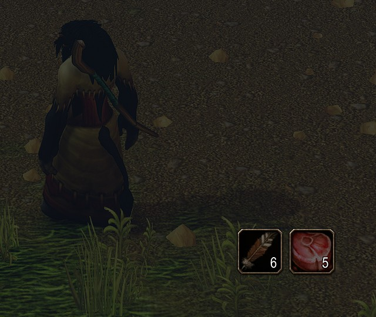
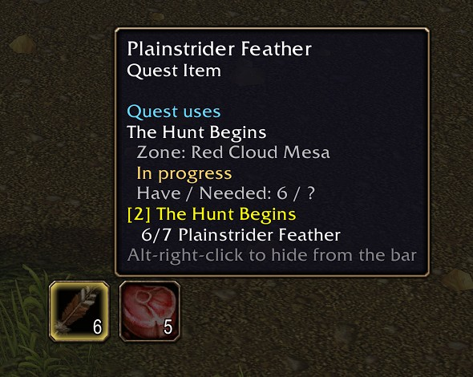
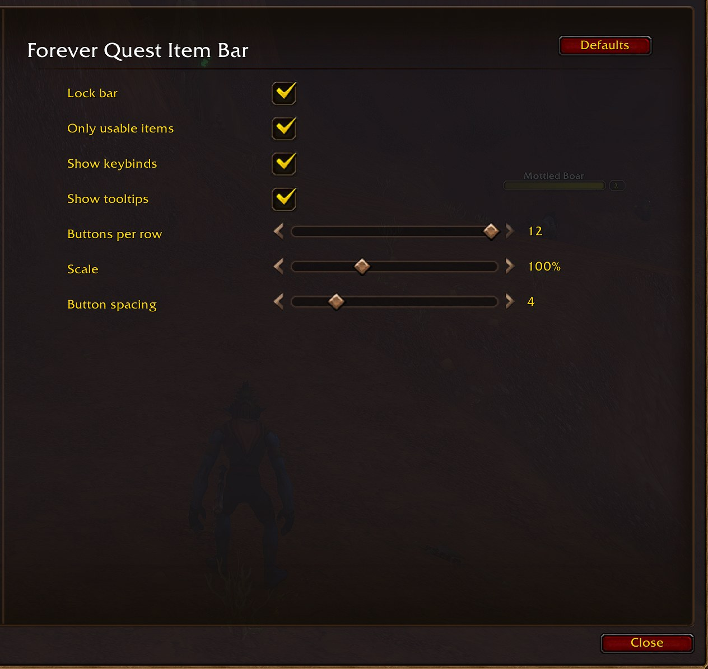

**An action bar for your quest items, made for WoW Forever.**

Whenever you carry a quest item you can use (the bomb you plant, the totem you place, the letter that starts a quest), a button for it appears on a bar that looks and clicks like one of Blizzard's own action bars. When you have none, the bar is gone.

No more digging through bags mid-fight for the thing the quest wants you to click.

*Shown with "Only usable items" turned off. The quest progress in the tooltip comes from Questie.*

**WoW Forever only** (interface 16001). Not built for Retail, TBC Anniversary or Classic Era.

## Features

- **Automatic.** One button per quest item in your bags and quest log. Loot one and its button appears; use the last one and it goes.
- **Looks like an action bar.** Blizzard's own button art, cooldown swipe, stack count, keybind text and range indicator. The keybind turns red when your target is out of range.
- **Keybindable.** Up to 12 buttons, each under *Key Bindings > AddOns > Forever Quest Item Bar*. Respects the *Cast action keybinds on key down* setting.
- **Usable items only, by default.** Collect-only drops (pelts, heads, trophies) are left off unless you turn the option off.
- **Hide what you don't want.** Alt-right-click a button to hide that item. `/fqib unhide` brings them back.
- **Chat links.** Shift-click a button to link the item.
- **Works in combat.** Clicking and keybinds work in combat. A quest item looted mid-fight gets its button when the fight ends.

## Getting started

The first time you log in, the bar is **unlocked**: a blue handle labelled *Quest Item Bar* sits below the middle of your screen.

1. Drag the handle to where you want the bar.
2. Type `/fqib lock`. The handle disappears and the buttons become clickable.
3. Pick up a usable quest item. Its button appears.

**Restart the game after installing.** A `/reload` does not pick up a newly installed addon.

## Controls

- **Click** a button: use the item
- **Keybind**: use the item in that slot (1 = leftmost)
- **Shift-click**: link the item in chat
- **Alt-right-click**: hide this item from the bar
- **Drag the blue handle** (unlocked): move the bar
- **Right-click the blue handle**: open settings

## Slash commands

`/fqib` or `/questbar`

- `/fqib` - open the settings
- `/fqib lock` - lock the bar so its buttons can be clicked
- `/fqib unlock` - show the drag handle so the bar can be moved
- `/fqib reset` - move the bar back to its default spot
- `/fqib unhide` - bring back every hidden item
- `/fqib help` - list the commands

## Settings

*Esc > Options > AddOns > Forever Quest Item Bar*, or `/fqib`.

- **Lock bar** - hide the drag handle so the buttons can be clicked
- **Only usable items** (on) - only items with a *Use:* effect or that start a quest
- **Show keybinds** (on) - show each button's bound key
- **Show tooltips** (on) - item tooltip on mouseover
- **Buttons per row** (12) - wrap onto a new row after this many
- **Scale** (100%) - size of the whole bar, 50-200%
- **Button spacing** (4) - gap between buttons

## Troubleshooting

**The bar never appears.** It only shows when you carry a qualifying item, or while unlocked. Type `/fqib unlock`: if the blue handle appears, the addon is running and you have no usable quest items. Try turning off *Only usable items*.

**A quest item is missing.** It has no *Use:* effect (turn off *Only usable items*), you hid it (`/fqib unhide`), or you looted it in combat (it appears when combat ends). Otherwise, please open an issue with the item's name.

**I can't click the buttons.** The bar is unlocked. Type `/fqib lock`.

**A button is greyed out.** You used the last one in combat; it disappears when combat ends.

## Source and issues

Full documentation, source and issue tracker: [github.com/paradosi/ForeverQuestItemBar](https://github.com/paradosi/ForeverQuestItemBar)
