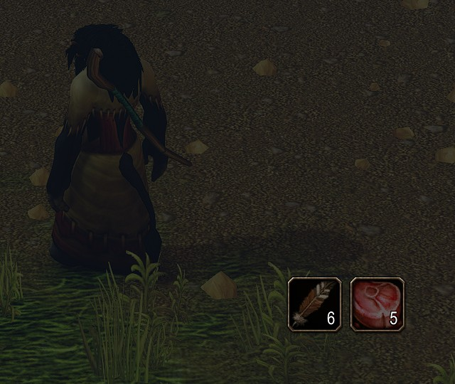
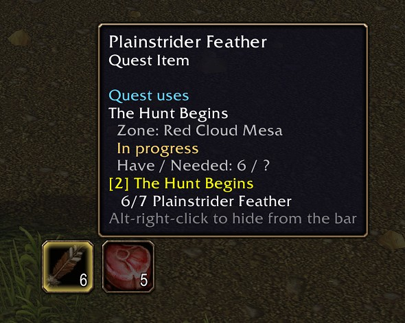
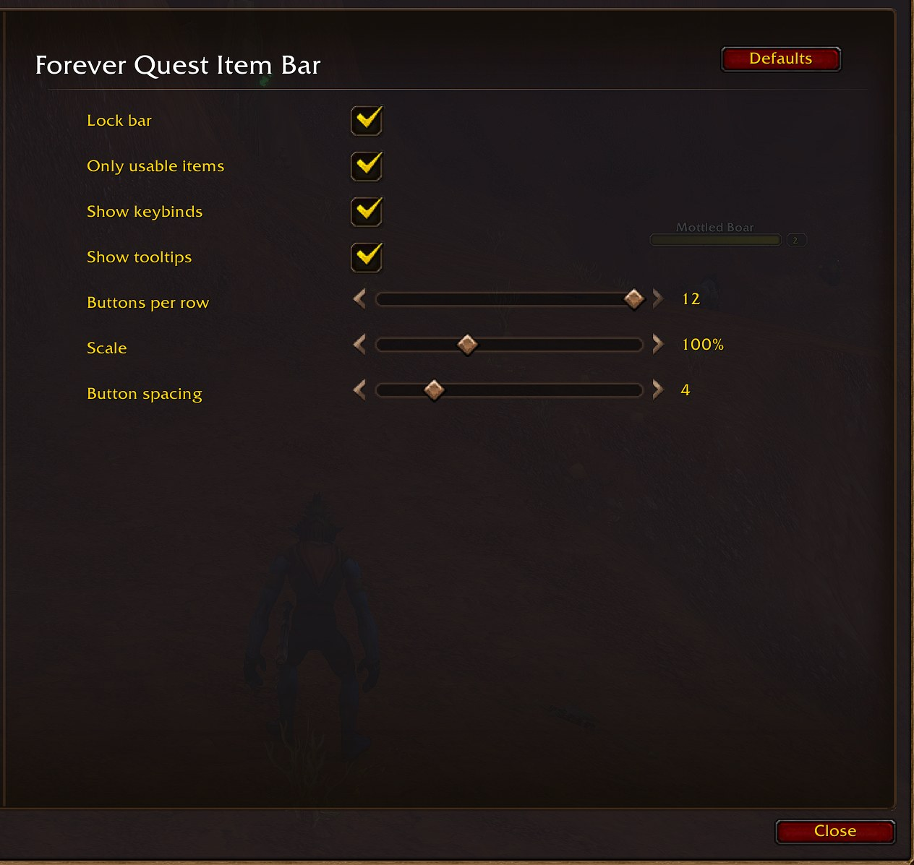

# Forever Quest Item Bar


An action bar for your quest items, made for **WoW Forever**. Whenever you are carrying
a quest item you can use (the bomb you plant, the totem you place, the letter that
starts a quest), a button for it appears on a bar that looks and clicks like one of
Blizzard's own action bars. When you have none, the bar is gone.

No more digging through bags mid-fight for the thing the quest wants you to click.

 

*Two collect-only quest items in Red Cloud Mesa, shown here with* Only usable items *turned
off. The tooltip is the game's own, with the quest's progress.*

> [!NOTE]
> This addon targets **WoW Forever only** (interface 16001). It is not built for Retail,
> TBC Anniversary or Classic Era. Every API it uses also exists there, so support could
> be added later; see [Design decisions](#design-decisions).

## Features

- **Automatic.** The bar scans your bags and quest log and shows one button per distinct
  quest item. Loot one and its button appears. Use the last one and it goes.
- **Looks like an action bar.** The buttons are Blizzard's own `ActionButtonTemplate`,
  so you get the same slot art, cooldown swipe, stack count, keybind text and range dot.
  The keybind turns red when your target is out of range.
- **Keybindable.** Up to 12 buttons, each with its own entry under
  *Key Bindings → AddOns → Forever Quest Item Bar*. Keybinds respect the game's
  *Cast action keybinds on key down* setting.
- **Usable items only, by default.** Quest drops you only collect (pelts, heads,
  trophies) have nothing to click, so they're left off unless you turn that option off.
- **Hide what you don't want.** Alt-right-click a button to hide that item for good.
  `/fqib unhide` brings hidden items back.
- **Chat links.** Shift-click a button to link the item, as with a bag slot.
- **Combat-safe.** Uses secure action buttons, so clicking works in combat (see
  [How it works](#how-it-works) for what waits until combat ends).

## Requirements

- WoW Forever (interface 16001).
- No libraries or other addons.

## Installation

**From a release:** install it from
[CurseForge](https://www.curseforge.com/projects/1788578) or
[Wago](https://addons.wago.io/addons/rNkgmwNa) with their apps, or
download the zip from
[GitHub Releases](https://github.com/paradosi/ForeverQuestItemBar/releases) and extract it
so the folder lands at:

```
C:\Program Files (x86)\World of Warcraft\_forever_\Interface\AddOns\ForeverQuestItemBar\
```

**From source:** clone this repository into that `AddOns` folder. The folder must be
named `ForeverQuestItemBar`.

> [!IMPORTANT]
> **Restart the game** after installing. A `/reload` does not pick up a newly installed
> addon. Then check that it is enabled in the AddOns list on the character screen.

## Usage

The first time you log in, the bar is **unlocked**: a blue handle labelled
*Quest Item Bar* sits below the middle of your screen, even if you have no quest items.

1. Drag the handle to where you want the bar.
2. Type `/fqib lock` (or tick *Lock bar* in the settings). The handle disappears and the
   buttons become clickable.
3. Pick up a usable quest item. Its button appears.

| Action | Result |
|---|---|
| Left- or right-click a button | Use the item |
| Keybind | Use the item in that slot (1 = leftmost) |
| Shift-left-click | Link the item in chat |
| Alt-right-click | Hide this item from the bar |
| Mouse over | Item tooltip |
| Drag the blue handle (unlocked) | Move the bar |
| Right-click the blue handle | Open settings |

### Slash commands

`/fqib` and `/questbar` are the same command.

| Command | Does |
|---|---|
| `/fqib` | Open the settings panel |
| `/fqib lock` | Lock the bar so its buttons can be clicked |
| `/fqib unlock` | Show the drag handle so the bar can be moved |
| `/fqib reset` | Move the bar back to its default spot |
| `/fqib unhide` | Bring back every item hidden with Alt-right-click |
| `/fqib help` | List these commands |

### Example: a quest with a usable item

You take a quest that hands you a *Sealed Letter* that starts another quest, and later
loot a *Smoldering Torch* the quest tells you to use on a pile of corpses.

- The letter gets a button straight away, because it starts a quest. Clicking it opens
  the quest dialog.
- The torch gets a button next to it. Target the corpse pile; while you are out of range
  the button's keybind (or its range dot, if unbound) is red. Walk closer and press it.
- When you turn in the quest and the torch is gone, its button disappears and the bar
  closes the gap.

## Configuration

*Esc → Options → AddOns → Forever Quest Item Bar*, or `/fqib`. Settings are saved per
account in `ForeverQuestItemBarDB`.



| Setting | Default | What it does |
|---|---|---|
| Lock bar | Off (on a new install) | Unlocked shows the drag handle and blocks clicks; locked hides it |
| Only usable items | On | Show only items with a *Use:* effect or that start a quest. Off also shows collect-only quest items |
| Show keybinds | On | Show each button's bound key. Off still shows the range dot |
| Show tooltips | On | Item tooltip on mouseover |
| Buttons per row | 12 | Wrap onto a new row after this many buttons |
| Scale | 100% | Size of the whole bar, 50–200% |
| Button spacing | 4 | Gap between buttons, 0–20 |

The bar's position and the list of hidden items are also saved, but have no control in
the panel. Use `/fqib reset` and `/fqib unhide`.

## Development

This folder is one of several addon repos under `~/projects/wowaddons`. The parent folder
holds the shared tooling.

| Command (from `~/projects/wowaddons`) | Does |
|---|---|
| `./check ForeverQuestItemBar` | The static gate: syntax, luacheck, TOC lint, API scan against Forever |
| `./check ForeverQuestItemBar --types` | Adds the lua-language-server type pass (advisory) |
| `./check ForeverQuestItemBar --package` | Builds the real release zip locally and inspects it |
| `wowdev deploy ForeverQuestItemBar --flavor forever` | Build and install on the game PC |
| `wowdev errors ForeverQuestItemBar --flavor forever` | Lua errors BugGrabber caught on the game PC |
| `wowdev bump ForeverQuestItemBar X.Y.Z -w` | Set the version in the TOC and add a changelog heading |

### Releasing

`.github/workflows/release.yml` runs
[BigWigsMods/packager](https://github.com/BigWigsMods/packager) on any tag push and
uploads to GitHub Releases. `CHANGELOG.md` is the release notes (`manual-changelog` in
`.pkgmeta`), so write its bullets for players.

```sh
wowdev bump ForeverQuestItemBar 1.0.1 -w   # then fill in the CHANGELOG bullets
./check ForeverQuestItemBar --package
git commit -am "v1.0.1" && git tag v1.0.1 && git push && git push --tags
```

> [!NOTE]
> Releases upload to CurseForge (project `1788578`) and Wago (`rNkgmwNa`), using the
> `## X-Curse-Project-ID:` and `## X-Wago-ID:` lines in the TOC and the repo's `CF_API_KEY`
> and `WAGO_API_TOKEN` secrets. A store whose secret is missing is skipped.

## Project structure

```
ForeverQuestItemBar/
├── ForeverQuestItemBar.toc   Interface 16001, load order, SavedVariables
├── Core.lua                  Saved variables, bag scan, refresh logic, events, slash commands
├── Bar.lua                   The bar frame, secure buttons, layout, visuals, drag handle
├── Options.lua               Settings panel
├── Bindings.xml              12 CLICK keybindings (loaded by the client; not listed in the TOC)
├── media/art/                Logo source (logo.svg) and PNG renders, README only (stripped from the zip)
├── media/textures/           logo_64.tga, the AddOns-list icon (shipped)
├── .pkgmeta                  Packager config: package name, changelog, files to strip
├── .github/workflows/        Release on tag push
├── CHANGELOG.md
└── LICENSE                   MIT
```

## How it works

### Deciding what is a quest item

On every bag or quest-log change, `ns:ScanItems()` walks the backpack and bags 1–5 and
keeps each distinct item that passes **both** tests:

1. **Is it a quest item?** Any one of these:
   - its item class is *Quest* (class 12);
   - `C_Container.GetContainerItemQuestInfo` reports `isQuestItem`;
   - it **starts a quest** (`questID` is set);
   - the quest log lists it as a quest's special item (`GetQuestLogSpecialItemInfo`).

   Vanilla's item data is inconsistent about which of these a given item carries, so
   any one is enough.
2. **Can you click it?** It has a *Use:* spell (`C_Item.GetItemSpell`), starts a quest,
   or is a quest-log item. This test is skipped when *Only usable items* is off.

Items you have hidden are skipped. The result is in **bag order** (backpack first, top
to bottom), which only changes if you rearrange your bags, so a keybind keeps pointing
at the same item.

### The buttons

Each of the 12 buttons is a `CheckButton` inheriting
`ActionButtonTemplate, SecureActionButtonTemplate`. This is the pairing Blizzard's
`BaseActionButtonMixin` documents as supported. The secure attributes are:

| Attribute | Value | Meaning |
|---|---|---|
| `type` | `item` | Every click uses an item… |
| `item` | `item:<itemID>` | …this one, found by ID wherever it is in your bags |
| `shift-type1` | `""` (no-op) | Shift-left-click does nothing securely; `PostClick` links the item |
| `alt-type2` | `""` (no-op) | Alt-right-click does nothing securely; `PostClick` hides the item |

The buttons register for both key-down and key-up clicks. A mouse click acts on release.
A keybind (`CLICK ForeverQuestItemBarButtonN:LeftButton`) acts on press or release,
following the `ActionButtonUseKeyDown` setting, as Blizzard's bars do.

### Combat

WoW forbids addons from changing a secure button's action, or moving, resizing, showing
or hiding it, while you are in combat. So the work is split:

| What | Out of combat | In combat |
|---|---|---|
| Which item each button uses | Updated immediately | Waits until combat ends |
| Bar size, position, scale, show/hide | Updated immediately | Waits until combat ends |
| Count, cooldown, usable / out-of-range colouring | Updated | Updated |

`ns:Refresh()` is the only path that changes the protected side. Called in combat, it
updates the visuals, sets `pendingRefresh`, and runs again on `PLAYER_REGEN_ENABLED`.

In practice:

- **A quest item looted mid-fight** gets its button when the fight ends.
- **Using your last one mid-fight** greys the button out, and it goes away when the
  fight ends.

### Range

The keybind text turns red when the item is out of range of your target, and an unbound
button shows a dot that does the same. This uses Blizzard's own
`ActionButton_UpdateRangeIndicator`. Range is polled every 0.2 s, but only while
the bar is visible and you have a target. Retail-engine clients restrict
`IsItemInRange` against friendly targets in combat, so **in combat, range is shown only
for hostile targets**.

### Events

| Event | Response |
|---|---|
| `BAG_UPDATE_DELAYED`, `QUEST_LOG_UPDATE`, `GET_ITEM_INFO_RECEIVED`, `PLAYER_ENTERING_WORLD` | Rescan, coalesced to at most one per 0.1 s |
| `PLAYER_REGEN_ENABLED` | Finish any refresh deferred by combat |
| `BAG_UPDATE_COOLDOWN`, `SPELL_UPDATE_USABLE` | Redraw counts, cooldowns, colours |
| `PLAYER_TARGET_CHANGED` | Recheck range |
| `UPDATE_BINDINGS` | Redraw keybind text |

## Design decisions

- **Blizzard's `ActionButtonTemplate`, not hand-drawn buttons.** The point is to look
  like a standard action bar, and on Forever that means Retail 12's art. Inheriting the
  template gets it exactly, and keeps getting it if Blizzard changes the art. Rejected:
  `ItemButtonTemplate` (bag-slot look, and absent on Forever), and drawing our own
  textures (would drift from the real bars).
- **Item ID, not bag/slot, in the secure attribute.** In combat the attribute is frozen.
  If the button held "bag 2, slot 5" and the stack moved, it would use the wrong
  item. `item:<id>` follows the item.
- **One bar with 12 fixed buttons.** The buttons need fixed global names for
  keybinds. Twelve covers any realistic Vanilla quest log. More than twelve qualifying
  items are dropped, last in bag order first.
- **Usable-only by default.** Collect-only quest items do nothing when clicked. Showing
  them makes the bar long and the useful buttons hard to find. The option exists for
  players who want the bar as a quest-loot overview.
- **Own drag handle rather than Edit Mode.** Edit Mode registration for addon frames is
  not public API, and a handle works the same way on every client.
- **Forever only, for now.** It is what the addon is for. Every API it calls also exists
  on Classic Era and TBC Anniversary (checked with `wow_compat`), except
  `C_QuestLog.GetNumQuestLogEntries`. That one is already guarded, so on those clients
  quest-log special items would just not be found. More TOCs could be added. The thing to
  test there would be the Classic look of `ActionButtonTemplate`.

## Troubleshooting

**The bar never appears.**
It only shows when you carry a qualifying item, or while unlocked. Type `/fqib unlock`: if
the blue handle appears, the addon is running and you simply have no usable quest items.
Try turning off *Only usable items*. If nothing appears at all, check the addon is enabled
on the character screen, and that you restarted the game (not `/reload`) after
installing.

**A quest item I expected is missing.**
Either it has no *Use:* effect (turn off *Only usable items*), you hid it
(`/fqib unhide`), or you picked it up in combat (it appears when combat ends). If none of
those apply, the item carries none of the quest markers listed in
[How it works](#how-it-works). Please open an issue with the item's name.

**A button is greyed out.**
You used the last one in combat. The button disappears when combat ends. A dimmed
button can also mean the item can't be used here or now, exactly as on an action bar.

**I can't click the buttons.**
The bar is unlocked. The blue handle covers the buttons so it can be dragged.
Type `/fqib lock`.

**My keybinds point at different items than before.**
Buttons follow bag order. Moving items between bags, or a new quest item landing earlier in
your bags, shifts the buttons along.

**"In combat: the bar will update when combat ends."**
Expected. See [Combat](#combat).

## License

MIT. See [LICENSE](LICENSE).
